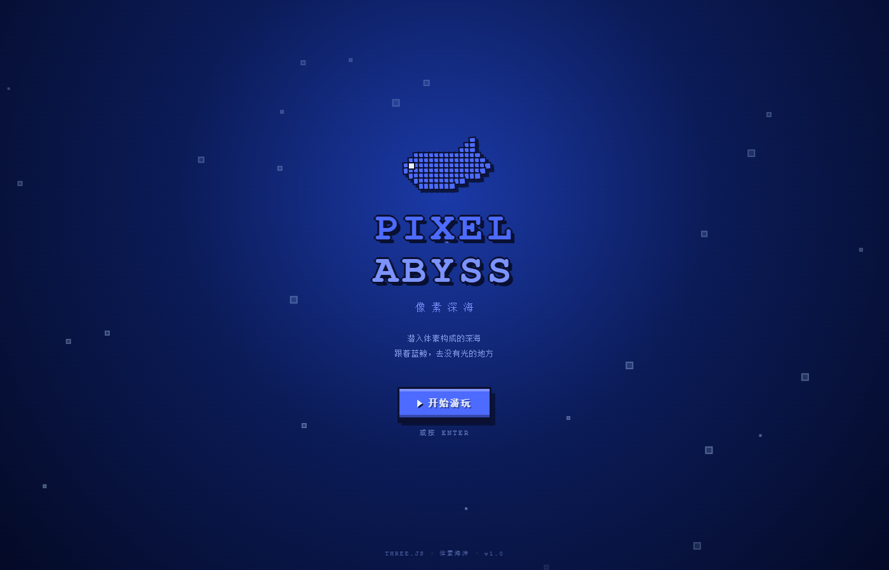
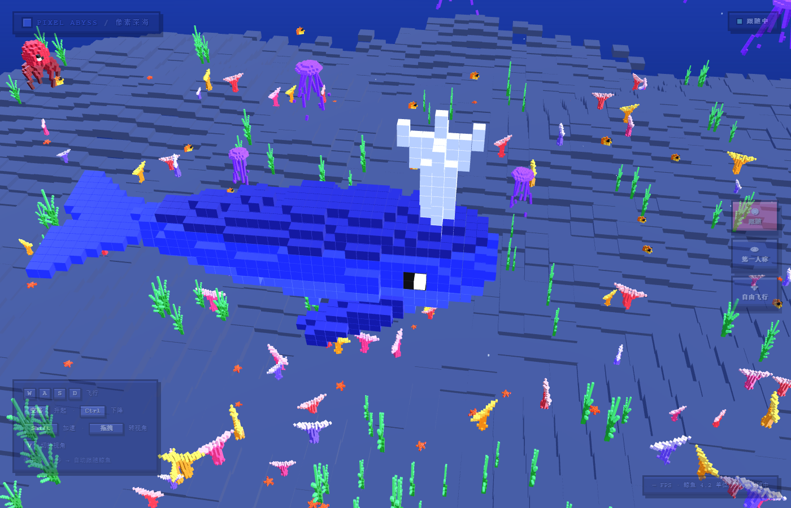

# PIXEL ABYSS · 像素深海

用 three.js 做的三维体素海底世界，主角是 DeepSeek 的鲸鱼形象。




**[▶ 在线体验](https://cl0ud-99.github.io/pixel-abyss/)** — 打开就能玩，不用安装任何东西

## 开屏页

进页面先看到开屏页：像素鲸鱼标志、`PIXEL ABYSS` 标题、中文名「像素深海」、上升气泡背景。
点「开始游玩」或按 **Enter** 进入。

场景在开屏期间已经在后台渲染，所以点开始是**无缝**进入，没有二次加载。

## 运行

**方式一：直接打开**

因为 three.js 走 CDN（见 `index.html` 的 importmap），仓库是零依赖的。
但浏览器对 `file://` 的模块加载有限制，建议起个静态服务器：

```bash
# Python（系统自带）
python -m http.server 5178

# 或 Node
npx serve .
```

**方式二：用项目自带的服务器**

```bash
NODE="C:/Users/Administrator/.dsh/dsh-runtimes/dsh-primary-runtime/dependencies/node/bin/node.exe"
"$NODE" serve.mjs
```

然后打开 <http://127.0.0.1:5178>。

> 不想用 CDN 也可以：`pnpm add three` 然后把 importmap 改回 `./node_modules/three/...`。

调试参数：

| 参数 | 作用 |
| --- | --- |
| `?skip=1` | 跳过开屏页直接进入 |
| `?skip=1&view=first` | 直接进第一人称 |
| `?skip=1&view=free` | 直接进自由飞行 |


然后打开 <http://127.0.0.1:5178>。

## 场景里有什么

**主角**
- 体素蓝鲸，2120 个体素，头顶喷水花

**游动的鱼群**
| 生物 | 数量 | 特点 |
| --- | --- | --- |
| 小丑鱼 | 7 | 橙白条纹，成群绕圈 |
| 蓝吊 | 5 | 蓝身黄尾 |
| 黄高鳍鱼 | 9 | 亮黄色，游得最快 |
| 神仙鱼 | 4 | 高瘦体型，银蓝条纹 |

**大型生物**
| 生物 | 数量 | 特点 |
| --- | --- | --- |
| 水母 | 6 | 伞盖脉动、触手飘荡，缓慢升降 |
| 海龟 | 2 | 四鳍划水，绕大圈巡游 |
| 章鱼 | 2 | 八条触手波浪式扭动 |

**海底静物**
| 生物 | 数量 | 特点 |
| --- | --- | --- |
| 海星 | 8 | 五角星，中心隆起，散落沙地 |
| 珊瑚 | 约 25 | 递归分叉，四种颜色 |
| 海草 | 约 27 | 每片叶子独立摆动 |

**环境**
- 体素沙地海床、渐变海水、上浮气泡、体积光柱

## 交互

### 三种视角

右侧有按钮可切换，也可以按 **V** 键循环：

| 视角 | 说明 |
| --- | --- |
| **跟随** | 第三人称，相机在鲸鱼侧后方（默认） |
| **第一人称** | 你就是这条鲸鱼，相机挂在吻端 |
| **自由飞行** | WASD 自己飞，停手 2.5 秒回到跟随 |

第一人称的细节：
- 相机挂在鲸鱼吻端（模型局部 `x = -19.8`），完全在体外，不会看到内部体素
- FOV 从 45 提到 **74**，视野更宽、更有沉浸感
- 朝向略滞后（`lagAmount`），转弯时有惯性感
- 转弯时相机绕视线轴侧倾，**限幅 8°** 且带平滑（见下方「镜头稳定性」）
- 有轻微呼吸起伏，跟摆尾节奏同步

### 镜头稳定性（撞墙不晃）

第一人称最容易出问题的地方：鲸鱼在边界处转向时，镜头会剧烈摇晃。
根因是三层抖动叠加，逐个修掉了：

| 问题 | 修法 | 效果 |
| --- | --- | --- |
| 相机直接用瞬时 `yawRate` 算侧倾 | 鲸鱼额外输出 `smoothYawRate`（低通一次），相机再平滑一次并限幅 | 角加速度峰值 **50.3 → 2.2** |
| `yawRate` 在目标方向附近来回微调 | P 控制加 **死区**（3.4°），偏差小时不修正 | 消除锯齿 |
| 目标点切换导致朝向瞬间跳变 | 选目标加 **1.2 秒冷却**，不会刚到达就重选 | 重选次数 32 → 9 |
| 鲸鱼卡在墙角原地打转 | 贴边时目标改为**朝场景内侧的远点**（不再是切向） | 贴边比例 85% → 15% |

实测（180 秒）：

```
相机角加速度   平均 0.24   p95 1.03   最大 2.19 rad/s²   (修复前 50.35)
侧倾变化率     平均 0.03   p95 0.13   最大 0.36 /s       (修复前 0.84)
角加速度尖峰   0 次                                    (修复前 66 次)
```

> 用 `tools/verify-fp-shake.mjs` 可以随时复测。

### 相机模式

| 操作 | 效果 |
| --- | --- |
| **W / S** | 前后飞行 |
| **A / D** | 左右平移 |
| **空格** | 升起 |
| **Ctrl** | 下降 |
| **Shift** | 加速（2.6 倍） |
| **V** | 循环切换视角 |
| 方向键 | 同 WASD |
| E / Q | 升起 / 下降（备用键，方便单手） |
| 鼠标拖拽 | 自由飞行时转视角；跟随时旋转观察 |
| 滚轮 | 缩放 |
| 停手 2.5 秒 | 自动交还跟随相机 |

优先级：**第一人称 > 自由飞行 > 跟随鲸鱼 > 用户拖拽**。按任意移动键立刻进入自由飞行，同时禁用 OrbitControls 和跟随逻辑，避免抢控制权。

> 空格和 Ctrl 都做了 `preventDefault`，不会滚动页面、也不会触发浏览器快捷键。
> 开屏期间输入是挂起的（`freeCam.suspend()`），点开始才恢复。

### 像素风 UI

界面是卡通像素风格，全部用 CSS 实现，没有图片资源：

- **粗描边面板** — 3px 黑边 + 内高光 + 内暗部 + 5px 硬投影
- **像素键帽** — 立体按键，底部暗边、顶部亮边，有实体感
- **硬阴影文字** — 用多重 `text-shadow` 模拟 1px 描边，不用模糊
- **模式徽章** — 右上角带闪烁指示灯，跟随=薄荷绿，自由飞行=金色
- **加载条** — `steps(8)` 步进动画，保持像素节奏

### 自由飞行的细节

- **速度平滑** — 用指数插值，按下不瞬间满速、松开不瞬间停（首帧位移 0.026，满速帧 0.167）
- **朝向独立维护** — 自己维护 yaw/pitch，不和 OrbitControls 的四元数打架
- **无跳变接管** — 进入时从当前相机四元数反解 yaw/pitch，视角不跳
- **边界约束** — 不能飞出场景，也不会钻进海床

## 鲸鱼会自己游

鲸鱼不再是原地摆动，而是真的在场景里巡游：

- **待在中心区域** — 目标点从「半径 62% 的圆盘」内随机取，鲸鱼大部分时间在中圈活动
- **散点而非圆周** — 目标点是随机散点，不是沿轨道绕圈，所以不会一直往一个方向拐
- **圆弧接近** — 接近目标点时不是直冲，而是在目标周围绕参考圆、沿切向滑过去
- **两级转向限制** — 角速度有上限、角加速度也有上限，转向是「加速转 → 匀速转 → 减速转」
- **急转弯只在撞墙时** — 巡航时角速度上限是 `turnRate × 62%`，只有贴近边界才放开到全速

### 转向档位

| 状态 | 角速度上限 | 效果 |
| --- | --- | --- |
| 正常巡游 | `1.05 × 62% = 0.65 rad/s` | 悠闲转弯 |
| 贴近边界 | `1.05 rad/s`（全速） | 能及时掉头，不会撞墙 |

实测 400 秒：

```
总体急转弯（>0.7 rad/s）占比:  0.4%    (改造前 12.5%)
贴边时（<20）急转弯占比:      18.8%   ← 该急就急
远离边界时急转弯占比:          0.1%   ← 悠闲巡游
最远离中心: 47.8 / 62                  (改造前 51.2，平均 31.7 → 23.8)
越界帧数: 0
```

> 用 `tools/verify-turn-profile.mjs` 可以复测「贴边 vs 远离」的转向分布。

### 平滑参数

| 参数 | 值 | 作用 |
| --- | --- | --- |
| `turnRate` | 1.05 | 最大角速度（rad/s），决定转弯半径 |
| `turnAccel` | 2.4 | 角加速度上限（rad/s²），越小起步越柔 |
| `turnGain` | 2.0 | P 控制增益，朝向偏差 → 期望角速度 |
| `arriveRadius` | 18 | 进入这个半径开始绕行 |
| `maxBank` | 0.42 | 侧倾上限（约 24°） |

## 相机跟随

相机自己维护一套「平滑朝向」，不直接吃鲸鱼的瞬时 heading：

- **朝向慢半拍** — 鲸鱼急转时，相机顺着弧线绕过去，而不是跟着朝向突变甩一下
- **位置弹簧** — 用 `1 - exp(-k·dt)` 做帧率无关的指数插值
- **侧后方机位** — `sideOffset` 0.85，能看到鲸鱼侧面轮廓和前进方向
- **海床保护** — `minCameraY` 防止相机钻进海底

实测 120 秒：

```
角加速度      平均 0.21   p95 1.36   最大 2.40 rad/s²
相机移动速度   平均 4.66   p95 8.33   最大 11.42 单位/s
视线角速度     平均 0.19   p95 0.69   最大 0.89 rad/s
侧倾最大 15.5°   相机速度尖峰 0 次
```

## 结构

```
index.html            页面 + importmap（不走打包器，改完刷新即可）
serve.mjs             静态服务器
src/voxel.js          体素建模原语（椭球、锥形肢体、多边形填充）
src/whaleShape.js     蓝鲸的体素模型
src/creatures.js      所有鱼和海底生物的体素模型
src/creatureObject.js 把体素数据转成 three.js 对象（含枢轴分组）
src/sea.js            游动行为：鱼群、水母、海龟、章鱼、海草
src/whaleAI.js        鲸鱼自主游动 + 跟随相机
src/freeCam.js        WASD 自由飞行相机
src/firstPerson.js    鲸鱼第一人称相机
src/splash.js         开屏页装饰（气泡、像素鲸鱼标志）
src/ui.css            卡通像素风 UI 样式
src/main.js           场景组装、光照、动画循环
tools/sim-swim.mjs    游动模拟（验证不越界）
tools/sim-camera.mjs  相机状态机验证
tools/verify-heading.mjs  朝向数值验证
tools/verify-smooth.mjs   转向/相机平滑度测量
tools/verify-fp-shake.mjs 第一人称镜头稳定性测量
tools/verify-turn-profile.mjs 转向分布测量（贴边 vs 远离）
tests/test-freecam.html    WASD 相机单元测试（14 项）
tests/test-integration.html  WASD 与跟随切换的集成测试（14 项）
tests/test-vertical.html     空格/Ctrl 升降测试（11 项）
tests/test-firstperson.html  第一人称相机测试（13 项）
tests/test-splash-ui.html    开屏页与视角按钮集成测试（26 项）
turn-path.html        转弯轨迹可视化（颜色 = 角速度）
views.html            蓝鲸四视图（检查造型用）
creatures.html        全部生物一览（检查造型用）
```

## 建模方式

所有生物都是**在三维体素网格里用原语拼出来的**，不是把 2D 像素画挤出成立体。

核心原语在 `voxel.js`：

- `ellipsoid()` — 椭球，用来堆身体、头、伞盖
- `taperedLimb()` — 沿曲线堆半径渐变的椭球，用来做鳍、触手、珊瑚枝
- `fillPolyXY()` / `fillPolyXZ()` — 多边形填充，用来做扁平的鳍

每种生物返回 `parts` 数组，每个 part 有自己的 **pivot（枢轴）**。把 pivot 放在根部，旋转它就能得到正确的摆动效果 —— 比如水母的每根触手都是独立 part，各自摆动。

## 踩过的坑

1. **颜色发暗** — `InstancedMesh.setColorAt()` 传入的 sRGB 值需要 `.convertSRGBToLinear()`，否则整体压暗一大截。
2. **色调映射** — 显式设 `renderer.toneMapping = THREE.NoToneMapping`，否则默认管线会把颜色压暗。
3. **别用低分辨率 + CSS 放大** — 会导致相机透视和画面尺寸对不上，直接按原生分辨率渲染。
4. **鱼是侧扁的** — 体厚只有体长的 1/6 左右，做厚了就不像鱼。尾鳍是**竖着**张开的（和鲸鱼的水平尾鳍相反）。
5. **海底砖块要重叠** — 相邻方块留缝会在光照下露出黑线，尺寸放大 4% 即可。
6. **鲸鱼朝向公式** — 模型头朝 -X，绕 Y 转 θ 后 -X 指向 `(-cos θ, 0, sin θ)`。要等于前进方向 `(sin h, 0, cos h)`，解得 `θ = h + π/2`。写成 `h - π/2` 会让鲸鱼倒着游。
7. **垂直避让不能用世界边界** — 否则鲸鱼会被一直往中间压，永远贴着海床。垂直方向要按「巡游高度区间」单独判定。
8. **跟随相机不能在拖拽中恢复** — 只看计时器会在用户长按 2.5 秒后抢走控制权，必须同时检查 `userInteracting`。
9. **角速度别额外乘衰减系数** — 一边加加速度一边乘衰减，两者拉锯会让角速度抖动，而且会突破限速上限。用「P 控制 + 加速度限制 + 硬限幅」就够了。
10. **靠边不要放大转向速度** — 之前靠边时把 `turnRate` 放大 1.4 倍「保证能掉头」，结果边界处反而转得最急。提前量 + 减速就够了。
11. **直线瞄准远目标会走成折线** — 直接瞄准远处目标点，鲸鱼会「直行→到位→急转→直行」，轨迹是多边形。改成在目标周围绕参考圆、瞄准切向，轨迹才是平滑弧线。
12. **相机要自己平滑朝向** — 直接用鲸鱼的瞬时 heading 算机位，鲸鱼一急转相机就甩。相机应维护独立的 `smoothHeading`，用最短路径角度插值追过去。
13. **第一人称不能用瞬时 yawRate** — 撞墙时 `yawRate` 会在正负之间翻转，直接乘侧倾系数会让镜头剧烈摇晃（实测角加速度峰值 50 rad/s²）。必须用低通后的值，并且限幅。
14. **「沿墙滑行」是个陷阱** — 贴着边界时把目标点放在墙的切向上，看似合理，但当鲸鱼卡在两面墙的角落时，目标点会落在身边 2 单位处，鲸鱼就**原地打转**（贴边比例 85%，一直在转）。改成「朝场景内侧的远点」后降到 15%。
15. **选目标要加冷却** — `距离 < 3.5 就重选` 会让鲸鱼在到达点附近反复切换目标，朝向跟着跳变。加 1.2 秒冷却即可。
16. **P 控制要有死区** — 朝向偏差很小时仍会修正，导致在目标方向附近来回微调。加 3.4° 死区，过渡用「减掉死区」而不是硬开关。
17. **端口** — 8099 这类端口会被 Windows 保留（`EACCES`），用 5178。
